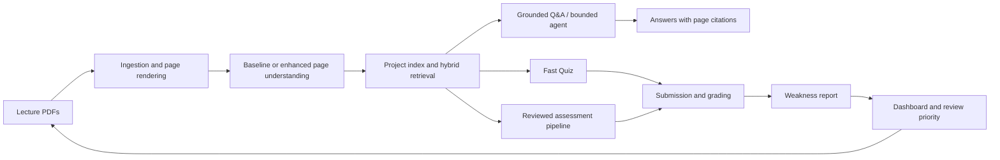

<p align="center">
  
</p>

<p align="center">
  Study your lecture slides, ask questions, and see where every answer came from.
</p>

# SlideTutor

Lecture slides are easy to collect and surprisingly hard to study from. Important ideas may be spread across several pages, and a normal AI chat can give a convincing answer without showing how it relates to the class material.

SlideTutor keeps the lecture beside the learning tools. You can upload one or more PDFs, move through the original pages, ask questions, make quizzes, and return to the exact slides you need to review. It runs locally, and answers include file and page references.

```text
Upload PDFs → read → ask → practise → review
```

## What it does differently

### The current slide comes first

When you ask for an explanation, SlideTutor starts with the page on the screen. It can use nearby or related pages when they help, but it does not quietly replace the slide you selected. Explanations, translations, answers, and quiz feedback link back to the source file and page.

### Questions stay inside the selected PDF

Free Ask can load a page, look at its neighbors, or search the current PDF. Those tools are read-only and have limits on time and calls. If the model provider cannot use them, SlideTutor returns to the simpler question-answering path instead of blocking the session.

### Reviewed exams are checked before use

**Reviewed Final Exam** does not accept the model's first set of questions as the final result. It plans the topics, connects questions to real slide content, checks their format and evidence, and performs one review before saving the exam:

```text
topic list
  → exam blueprint
  → source pages
  → question generation
  → automatic checks
  → one model review
  → saved exam
```

You can inspect the plan, source pages, and check results. Reviewed exams support several question formats. **Fast Quiz** is still available when you want a shorter practice session.

### A wrong answer points to what to study next

After a quiz, SlideTutor shows feedback for each question and links to useful review pages. The Learning Dashboard keeps a history of weak topics, and unanswered mistakes can appear again in later practice. This makes it easier to decide what to open next instead of simply looking at a score.

## Core capabilities

| Area | What SlideTutor provides |
| --- | --- |
| Course workspace | Multiple PDFs per project, page thumbnails, ordering, navigation, and full-width previews |
| Page understanding | PyMuPDF baseline extraction with optional Marker-enhanced Markdown and safe fallback |
| Questions and explanations | Explain, Translate, and Free Ask with file/page citations |
| Retrieval | Current-page context, neighboring pages, lexical BM25, dense retrieval, and rank fusion |
| Bounded agent | Provider tool calling with scope, call, round, cancellation, and timeout controls |
| Assessment | Per-PDF quizzes, course-level final exams, mixed question types, and AI grading where semantic judgment is required |
| Reviewed exams | Topic planning, source binding, automatic checks, one review pass, and saved check results |
| Learning feedback | Scores, answer explanations, weakness reports, cited review links, quiz history, and review priorities |
| Reliability | Pydantic contracts, content-addressed caches, background jobs, staged activation, cancellation, and regression tests |

## Included demo courses

The public repository includes six lecture decks so evaluators can try both single-file and multi-file course workflows without supplying private material:

| Course | Included decks |
| --- | --- |
| Statistical Learning Theory | Regression, Neural Networks, Graph Neural Networks |
| Introduction to Behavioral Neuroscience | Learning, Memory, Spatial Memory |

The files are under [`demo/statistical-learning/`](demo/statistical-learning/) and [`demo/behavioral-neuroscience/`](demo/behavioral-neuroscience/). Create one project per course and upload its three PDFs together to demonstrate cross-file retrieval, Reviewed Final Exam, quiz feedback, and the Learning Dashboard.

## Architecture



All runtime data is stored under `.slide_tutor_data/projects/{project_id}/` and is excluded from Git.

## Quick start

### Requirements

- Python 3.11
- A modern browser
- An OpenAI-compatible LLM endpoint, or a local Ollama model
- PDF files containing material you are allowed to process

The project was developed and tested on macOS. It should also run in another Python 3.11 environment when its native dependencies are available.

### 1. Clone and install

Using Conda:

```bash
git clone https://github.com/Deepinsnoweo/Lecture-Slide-Tutor.git
cd Lecture-Slide-Tutor

conda create -n SlideTutor python=3.11 -y
conda activate SlideTutor
pip install -r requirements.txt
```

Or use a standard virtual environment:

```bash
git clone https://github.com/Deepinsnoweo/Lecture-Slide-Tutor.git
cd Lecture-Slide-Tutor

python3.11 -m venv .venv
source .venv/bin/activate
python -m pip install --upgrade pip
pip install -r requirements.txt
```

### 2. Configure a model provider

Copy the example file:

```bash
cp .env.example .env
```

Then set an OpenAI-compatible endpoint in `.env`:

```dotenv
SLIDE_TUTOR_BASE_URL=https://your-provider.example/v1
SLIDE_TUTOR_API_KEY=your-api-key
SLIDE_TUTOR_MODEL=your-model-name
```

For local Ollama:

```bash
ollama pull llama3.2
```

```dotenv
SLIDE_TUTOR_BASE_URL=http://localhost:11434/v1
SLIDE_TUTOR_API_KEY=ollama
SLIDE_TUTOR_MODEL=llama3.2
```

Never commit `.env`; it is already ignored by Git.

### 3. Start SlideTutor

```bash
streamlit run app.py
```

Open [http://localhost:8501](http://localhost:8501), create a project, and upload one or more PDFs.

## Optional agent and parsing features

SlideTutor works without enabling the multi-round agent. To test it with a provider that has been verified to support compatible tool calls:

```dotenv
SLIDE_TUTOR_QA_AGENT=true
SLIDE_TUTOR_QA_AGENT_MAX_ROUNDS=3
SLIDE_TUTOR_QA_AGENT_MAX_CALLS_PER_ROUND=4
SLIDE_TUTOR_QA_AGENT_MAX_TOTAL_CALLS=6
SLIDE_TUTOR_QA_AGENT_MAX_SECONDS=45
```

The multilingual sentence-transformer and Marker parser are local-files-only by default. When their model files are unavailable, retrieval/parser paths degrade to lighter local fallbacks rather than blocking the basic application. To intentionally allow initial model downloads, review the privacy and storage implications and set the relevant `*_LOCAL_FILES_ONLY` variables in `.env` to `false`.

## Using the application

1. Create a project in the sidebar.
2. Upload one or more text-based PDF lecture decks.
3. Browse to a page and choose Explain, Translate, or Free Ask.
4. Optionally build the enhanced project index for stronger page understanding and retrieval.
5. Choose **Take quiz**, then select a per-PDF quiz or final exam and the desired quality mode.
6. Submit answers to reveal grading, explanations, citations, and the weakness report.
7. Use **Dashboard** and answer/quiz history to continue reviewing.

## Verification

Run the complete local suite:

```bash
python -m pip install pytest
python -m compileall app.py slide_tutor tests
python -m pytest tests/ -q
```

Latest verification of this published snapshot at the time this README was prepared:

```text
305 passed, 1 skipped
```

The skipped test validates internal evaluation fixtures under `Docs/eval/`; those artifacts are intentionally excluded from the public snapshot. The complete local development repository passes all 306 tests.

Tests mock external model/parser calls unless a command explicitly performs a live-provider evaluation. Live evaluations require your own credentials and should never persist API keys, full prompts, private slide text, or raw provider responses in the repository.

## Project structure

```text
app.py                         Streamlit entry point
slide_tutor/
  ingestion.py                PDF ingestion and page extraction
  generation.py               Baseline/enhanced generation lifecycle
  index_store.py              Index construction and activation
  retrieval.py                Hybrid retrieval
  qa_context.py               Grounded context assembly
  qa_agent.py                 Bounded multi-round retrieval agent
  quiz_quality.py             Reviewed assessment pipeline
  quiz_submission.py          Submission and grading workflow
  dashboard.py                Learning-state projections
  models.py                   Persisted and cross-module contracts
  ui.py                       Streamlit interface
tests/                         Unit and regression tests
assets/                        SlideTutor logo and icon
demo/
  statistical-learning/       Three statistical-learning lecture PDFs
  behavioral-neuroscience/    Three behavioral-neuroscience lecture PDFs
```

## Privacy and limitations

- SlideTutor is currently a local, single-user application; it does not provide hosted accounts or access control.
- Uploaded PDFs, rendered pages, indexes, answers, and quiz attempts remain under `.slide_tutor_data/` on the machine running the app.
- The six bundled files under `demo/` are the only PDFs in this repository. Other local course material is excluded.
- Retrieved slide text is sent to the model provider configured by the user. Use a local provider for material that must not leave the device.
- The current upload contract supports PDF files. Scanned documents, complex formulas, and diagrams may need review when extraction quality is limited.
- Marker enhancement and dense retrieval depend on optional local model assets; safe fallback paths prioritize availability over perfect extraction quality.
- Generated explanations, questions, and grading are learning aids. Students and instructors should verify important conclusions against the cited slides.

## Repository publication scope

This public repository intentionally contains only the runnable application, tests, environment template, brand assets, this README, and the six demonstration PDFs listed above. Internal planning notes, process logs, evaluation artifacts, private uploads, cached indexes, answers, and all other project documents are excluded.
